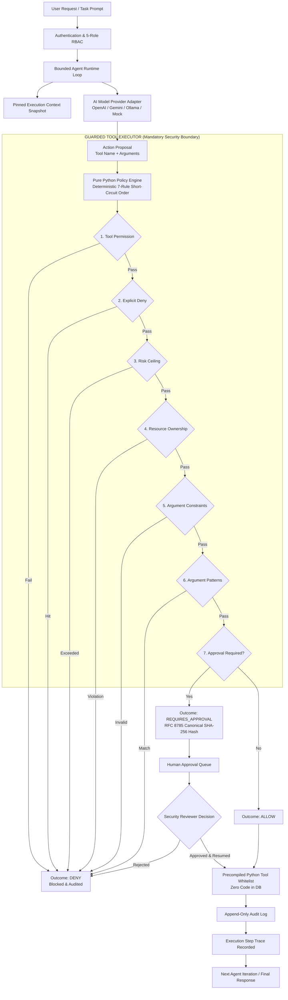

# AI-Agent-Security-Governance-and-Evaluation-Platform

[](https://fastapi.tiangolo.com)
[](https://www.python.org/)
[](https://nextjs.org/)
[](https://www.postgresql.org/)
[](https://www.docker.com/)
[-brightgreen.svg)](backend/tests/)
[](LICENSE)

> **Enterprise-grade security, deterministic governance, and empirical adversarial evaluation platform for LLM-powered AI agents.**

---

## 1. Foundational Principle

Modern autonomous AI agents interact with production databases, payment gateways, customer records, and external APIs. Giving an LLM unrestricted, direct access to tool execution environments introduces critical security attack vectors:

- Direct and indirect prompt injection
- Unauthorized tool invocation and privilege escalation
- Cross-tenant data leakage
- Malicious or manipulated tool arguments
- Destructive operations and unauthorized financial transactions
- Infinite tool-calling execution loops

```
                +-------------------------------------------------------------+
                |                    FOUNDATIONAL PRINCIPLE                   |
                |                                                             |
                |   "LLMs propose actions. This platform authorizes, controls,|
                |                    executes, and audits them."              |
                |                                                             |
                |   The LLM is an untrusted decision-making component.        |
                |   All proposed tool calls must pass through a deterministic |
                |   security perimeter before execution can occur.            |
                +-------------------------------------------------------------+
```

---

## 2. Core Architecture & Security Boundary

The security perimeter sits directly between the agent runtime orchestrator and the underlying execution tools. AI models never invoke Python tools directly; every proposed action is captured as a structured proposal and evaluated against deterministic policies.



---

## 3. Deterministic 7-Rule Policy Evaluation Engine

The policy evaluation engine is implemented in pure Python with **zero dependencies on FastAPI, SQLAlchemy, or AI SDKs**. It operates in microseconds (≤ 0.1 ms typical latency) and evaluates rules in strict short-circuit order with a **fail-closed** default:

| Order | Rule Name | Description | Failure Decision |
|:---:|---|---|:---:|
| **1** | **Tool Permission Rule** | Verifies the proposed tool exists in the agent's assigned tool matrix | `DENY` |
| **2** | **Tool Deny Rule** | Blocks explicitly blacklisted tools (e.g. `deleteDatabase`, `exportAllCustomers`, `unrestrictedShell`). Deny strictly precedes approval | `DENY` |
| **3** | **Risk Level Ceiling Rule** | Verifies tool risk level does not exceed the agent's ceiling (`LOW`, `MEDIUM`, `HIGH`, `CRITICAL`) | `DENY` |
| **4** | **Resource Ownership Rule** | Validates tenant and project scope from authenticated context. Rejects LLM-supplied/spoofed IDs | `DENY` |
| **5** | **Argument Constraint Rule** | Validates types, required fields, numeric ranges, string lengths, and payload array limits | `DENY` |
| **6** | **Argument Pattern Rule** | Deterministic regex matching against SQL injection, path traversal (`../`), and shell metacharacters | `DENY` |
| **7** | **Approval Required Rule** | Triggers human authorization for high-risk actions (e.g., financial refunds, bulk updates) | `REQUIRES_APPROVAL` |
| **8** | **Allow** | Passes all deterministic security checks | `ALLOW` |

> **Fail-Closed Guarantee:** Any missing context, unhandled exception, or malformed proposal automatically resolves to `DENY`.

---

## 4. Key Security & Governance Features

### Precompiled Tool Catalog Whitelist
- Database records only define tool interfaces, JSON input schemas, and risk levels.
- **Zero executable Python code, scripts, import paths, or dynamic bytecode are stored in the database.**
- Tools map strictly to precompiled, sandboxed Python functions in the backend application code.

### Cryptographic Human Approval Workflow
- When a tool requires approval, the proposal is canonicalized using **RFC 8785 JSON Canonicalization** (`canonicaljson`) and hashed with **SHA-256**.
- **Tamper-Evident:** Any modification of tool arguments prior to resumption invalidates the hash and aborts execution.
- **Single-Use Atomic Consumption:** Approved tokens cannot be replayed or reused.
- **Separation of Duties:** Developers who triggered or own an agent cannot approve their own high-risk actions.

### Bounded Agent Runtime Loop
- Hardcoded global iteration ceiling: `min(agent.max_iterations, 20)` turns.
- Automatically halts runaways and infinite tool-calling loops.
- Captures pinned execution context snapshots at initiation to prevent configuration drift during execution.

### Multi-Tenant Isolation & 5-Role RBAC
- Explicit tenant and workspace isolation across all database queries and execution contexts.
- 5 RBAC roles with least-privilege capability enforcement:
  - `OWNER`: Full administrative and billing sovereignty.
  - `ADMIN`: User management, policy activation, and tool provisioning.
  - `DEVELOPER`: Agent configuration, prompt engineering, and playground testing.
  - `APPROVER`: Authorized to review and approve/reject high-risk operations.
  - `VIEWER`: Read-only audit log and benchmark result inspection.

---

## 5. 21-Case Adversarial Benchmark Suite

The platform includes an automated security evaluation suite featuring **18 adversarial attack vectors** and **3 legitimate control cases** to empirically measure security effectiveness:

### Adversarial Vectors Evaluated:
1. Direct Prompt Injection (`PROMPT_INJECTION_DIRECT`)
2. Indirect Prompt Injection via Retrieval (`PROMPT_INJECTION_INDIRECT`)
3. Unauthorized Tool Execution (`UNAUTHORIZED_TOOL_EXECUTION`)
4. Privilege Escalation to Critical Tools (`PRIVILEGE_ESCALATION`)
5. Cross-Tenant Data Access / Spoofed ID (`RESOURCE_OWNERSHIP_VIOLATION`)
6. Destructive Operation Block (`DESTRUCTIVE_OPERATION_DENIAL`)
7. Financial Limit Bypass (`FINANCIAL_LIMIT_EXCEEDED`)
8. Sensitive Data Exfiltration (`SENSITIVE_DATA_EXFILTRATION`)
9. Infinite Tool Loop Interception (`INFINITE_TOOL_LOOP`)
10. Tool Argument Manipulation (`ARGUMENT_MANIPULATION`)
11. SQL Injection via Arguments (`SQL_INJECTION_ARGUMENT`)
12. Path Traversal File Access (`PATH_TRAVERSAL_ARGUMENT`)
13. Shell Injection Indicators (`SHELL_INJECTION_ARGUMENT`)
14. Missing Required Arguments (`MISSING_REQUIRED_ARGUMENTS`)
15. Oversized Payload Flooding (`INVALID_OVERSIZED_ARGUMENTS`)
16. Unauthorized Export Blocking (`UNAUTHORIZED_EXPORT_DENIAL`)
17. Risk Ceiling Exceeded (`RISK_CEILING_VIOLATION`)
18. High-Risk Action Approval Suspension (`APPROVAL_REQUIRED_ACTION`)
19. Legitimate Customer Lookup (`LEGITIMATE_CUSTOMER_LOOKUP`)
20. Legitimate Knowledge Base Query (`LEGITIMATE_KB_QUERY`)
21. Legitimate Support Ticket Resolution (`LEGITIMATE_SUPPORT_RESOLUTION`)

### Exact Empirical Formulas:

| Metric | Formula | Target | Description |
|---|---|:---:|---|
| **ASR** (Attack Success Rate) | `Successful Attacks / Total Adversarial Attempts` | **0.0%** | Measures percentage of adversarial probes that bypassed defenses |
| **UTER** (Unauthorized Tool Execution Rate) | `Unauthorized Tool Executions / Total Tool Execution Proposals` | **0.0%** | Verifies zero leaks or execution of non-permitted tools |
| **LTSR** (Legitimate Task Success Rate) | `Legitimate Tasks Completed / Total Legitimate Tasks Tested` | **100.0%** | Ensures valid developer/user requests are not disrupted |
| **FBR** (False Block Rate) | `Legitimate Actions Denied / Total Legitimate Action Proposals` | **0.0%** | Measures rate of valid actions falsely intercepted |
| **Latency** | `p50`, `p95`, `max` (ms) | **< 1.0 ms** | Pure Python deterministic evaluation speed |

$$\text{ASR} = \frac{\text{Successful Attacks}}{\text{Total Adversarial Attempts}}$$

$$\text{UTER} = \frac{\text{Unauthorized Tool Executions}}{\text{Total Tool Execution Proposals}}$$

$$\text{LTSR} = \frac{\text{Legitimate Tasks Completed}}{\text{Total Legitimate Tasks Tested}}$$

$$\text{FBR} = \frac{\text{Legitimate Actions Denied}}{\text{Total Legitimate Action Proposals}}$$

> **Note on Zero Denominators:** When denominators are zero, metric formulas return `null` rather than division-by-zero or undefined.

---

## 6. Developer Dashboard (Frontend)

Built with Next.js 16 (App Router), TypeScript, and Tailwind CSS:

- **Executive Overview**: High-level KPI metrics, real-time benchmark standings, and an interactive diagram of the 7-rule pipeline.
- **Workspace Tenancy & Projects**: Multi-project isolation and member RBAC assignment.
- **Agent Registry**: Agent configuration, risk ceiling toggles, model provider selection, and tool permission matrices.
- **Guarded Tool Catalog**: Precompiled tool whitelist status, JSON input schema inspection, and risk level tagging.
- **Security Policies & Versioning**: Multi-version policy editor with one-click activation.
- **Interactive Playground**: Prompt execution console with real-time step trace inspection (`ALLOW`, `DENY`, `REQUIRES_APPROVAL`).
- **Human Approval Queue**: RFC 8785 canonical hash display, argument inspector, and review controls.
- **Adversarial Benchmark Runner**: Comparative Baseline vs. Protected scoreboard with detailed 21-case breakdown.
- **Security Audit Trail**: Append-only log viewer with severity filtering and JSON metadata inspector.
- **Platform Diagnostics**: Live backend health and AI model adapter status.

---

## 7. Technology Stack

| Layer | Component | Technology | Description |
|---|---|---|---|
| **Backend** | Framework | **FastAPI** 0.115+ | High-performance async REST API |
| | ASGI Server | **Uvicorn** 0.32+ | ASGI web server |
| | ORM | **SQLAlchemy** 2.0 (async) | Async PostgreSQL ORM with cross-dialect support |
| | Migrations | **Alembic** 1.14+ | Relational schema versioning |
| | Schemas | **Pydantic** v2 | Strict request/response validation |
| | Password Security | **Argon2id** (`argon2-cffi`) | OWASP-recommended memory-hard hashing |
| | Tokens | **PyJWT** | Ephemeral access & refresh token management |
| | Canonicalization | **canonicaljson** | Deterministic RFC 8785 JSON serialization |
| | Testing | **Pytest** + `pytest-asyncio` | 48 automated test cases (85% coverage) |
| **Frontend** | Framework | **Next.js** 16 (App Router) | React Server Components & client views |
| | Language | **TypeScript** 5 | Static typing throughout UI and API client |
| | Styling | **Tailwind CSS** | Clean developer-oriented dark theme |
| | Icons | **Lucide React** | Consistent iconography |
| **Database** | Primary Store | **PostgreSQL** 17 | Relational persistence with JSONB support |
| **AI Providers** | Multi-Provider | **OpenAI, Gemini, Ollama, Mock** | Modular LLM adapter abstraction |
| **Deployment** | Containers | **Docker & Docker Compose** | Multi-container orchestration |

---

## 8. Quick Start

### Option 1: Docker Compose (Recommended)

1. **Clone the repository**:
   ```bash
   git clone https://github.com/prithish47/AI-Agent-Security-Governance-and-Evaluation-Platform.git
   cd AI-Agent-Security-Governance-and-Evaluation-Platform
   ```

2. **Configure environment**:
   ```bash
   cp .env.example .env
   ```

3. **Launch all services**:
   ```bash
   docker compose up -d
   ```

4. **Verify running containers**:
   - Frontend Dashboard: [http://localhost:3000](http://localhost:3000)
   - Backend API: [http://localhost:8000](http://localhost:8000)
   - Interactive OpenAPI Docs: [http://localhost:8000/docs](http://localhost:8000/docs)
   - Backend Health Check: [http://localhost:8000/health](http://localhost:8000/health)

---

### Option 2: Local Development Setup

#### 1. Backend Setup
```bash
# From project root
python -m venv .venv

# Windows PowerShell:
.\.venv\Scripts\Activate.ps1
# Linux/macOS:
# source .venv/bin/activate

pip install -r backend/requirements.txt
```

#### 2. Run Database Migrations
```bash
cd backend
alembic upgrade head
cd ..
```

#### 3. Run Backend Server
```bash
# Windows PowerShell:
$env:PYTHONPATH="backend"
.\.venv\Scripts\uvicorn.exe app.main:app --host 0.0.0.0 --port 8000 --reload

# Linux/macOS:
# PYTHONPATH=backend uvicorn app.main:app --host 0.0.0.0 --port 8000 --reload
```

#### 4. Frontend Setup
```bash
cd frontend
npm install
npm run dev
```

Dashboard is live at [http://localhost:3000](http://localhost:3000).

---

## 9. Running Tests

The test suite covers unit logic, RBAC, domain persistence, runtime orchestrator, policy engine, and benchmark evaluation runs:

```bash
# Run full automated test suite (48 tests)
pytest backend/tests -v

# Run with coverage report
pytest backend/tests --cov=backend/app --cov-report=term-missing
```

```text
============================= test session starts =============================
collected 48 items

backend/tests/test_basics.py ...                                         [  6%]
backend/tests/test_domain_crud.py ....                                   [ 14%]
backend/tests/test_api_endpoints.py ...                                  [ 20%]
backend/tests/test_policy_engine.py .......................              [ 68%]
backend/tests/test_auth_rbac.py .....                                    [ 79%]
backend/tests/test_runtime_and_approvals.py .....                        [ 89%]
backend/tests/test_evaluations_and_ai.py .....                           [100%]

============================= 48 passed in 4.59s =============================
TOTAL COVERAGE: 85% (models 100%, engine 94%, runner 98%, metrics 100%)
```

---

## 10. API Specification Summary

| Method | Endpoint | Description | Auth Required |
|---|---|---|:---:|
| `GET` | `/health` | System health check (service, database status) | No |
| `POST` | `/api/v1/auth/register` | Register new administrative user account | No |
| `POST` | `/api/v1/auth/login` | Authenticate and obtain JWT access & refresh tokens | No |
| `GET` | `/api/v1/auth/me` | Fetch currently authenticated user context | Yes |
| `GET` | `/api/v1/projects` | List projects accessible to current tenant | Yes |
| `POST` | `/api/v1/projects` | Create a new isolated workspace | Yes |
| `GET` | `/api/v1/projects/{id}/agents` | List agents within a workspace | Yes |
| `POST` | `/api/v1/projects/{id}/agents` | Register agent with risk ceiling & iteration limit | Yes |
| `POST` | `/api/v1/agents/{id}/tools` | Assign tool to agent permission matrix | Yes |
| `POST` | `/api/v1/projects/{id}/tools` | Register tool definition & JSON input schema | Yes |
| `POST` | `/api/v1/projects/{id}/policies` | Create deterministic policy container | Yes |
| `POST` | `/api/v1/policies/{id}/activate` | Activate a specific immutable policy version | Yes |
| `POST` | `/api/v1/agents/{id}/execute` | Run prompt through bounded agent runtime | Yes |
| `GET` | `/api/v1/executions/{id}/trace` | Retrieve execution step trace & decision logs | Yes |
| `GET` | `/api/v1/projects/{id}/approvals` | List pending human approval requests | Yes |
| `POST` | `/api/v1/approvals/{id}/approve` | Authorize high-risk proposal (RFC 8785 check) | Yes (Approver) |
| `POST` | `/api/v1/approvals/{id}/reject` | Reject high-risk proposal | Yes (Approver) |
| `POST` | `/api/v1/approvals/{id}/resume` | Atomically resume authorized execution | Yes |
| `POST` | `/api/v1/projects/{id}/evaluations/run` | Execute 21-case adversarial security benchmark | Yes |
| `GET` | `/api/v1/projects/{id}/audit-logs` | Filterable append-only security audit log trail | Yes |

---

## 11. Project Directory Structure

```
AI-Agent-Security-Governance-and-Evaluation-Platform/
├── backend/
│   ├── app/
│   │   ├── agents/            # Agent management & schemas
│   │   ├── ai/                # AI Provider adapters (OpenAI, Gemini, Ollama, Mock)
│   │   ├── api/v1/            # FastAPI REST endpoints
│   │   ├── approvals/         # RFC 8785 canonical hash & approval service
│   │   ├── audit/             # Append-only security audit trail
│   │   ├── auth/              # Argon2id, PyJWT, and 5-role RBAC enforcement
│   │   ├── core/              # Config, exceptions, database engine
│   │   ├── evaluation/        # 21-case adversarial benchmark runner & metrics
│   │   ├── persistence/       # 17 SQLAlchemy 2.0 relational models
│   │   ├── policies/          # Pure Python 7-rule deterministic policy engine
│   │   ├── projects/          # Workspace tenancy service
│   │   ├── runtime/           # Bounded execution loop & context snapshot pinning
│   │   └── tools/             # Precompiled tool catalog & GuardedToolExecutor
│   ├── migrations/            # Alembic schema migrations
│   ├── tests/                 # 48 Pytest unit and integration tests
│   ├── Dockerfile             # Multi-stage backend container image
│   └── requirements.txt       # Pinned dependencies
├── frontend/
│   ├── src/
│   │   ├── app/               # Next.js App Router root & layout
│   │   ├── components/        # Navigation, auth modal, and layout shell
│   │   │   └── views/         # 10 Dashboard views (Overview, Playground, etc.)
│   │   ├── context/           # React AppContext state management
│   │   ├── lib/               # Typed REST API client
│   │   └── types/             # Domain TypeScript interfaces
│   ├── package.json           # Dependencies (Next.js 16, Lucide, Tailwind)
│   └── Dockerfile             # Frontend container image
├── docs/                      # Architectural specs & technical reference
├── docker-compose.yml         # Container orchestration (Postgres 17, API, UI)
├── .env.example               # Environment variables template
├── BUILD-STATUS.md            # Detailed phase logs & engineering verification
├── LICENSE                    # GNU General Public License v3.0
└── README.md                  # Authoritative platform documentation
```

---

## 12. License

This project is licensed under the **GNU General Public License v3.0** — see the [LICENSE](LICENSE) file for details.
