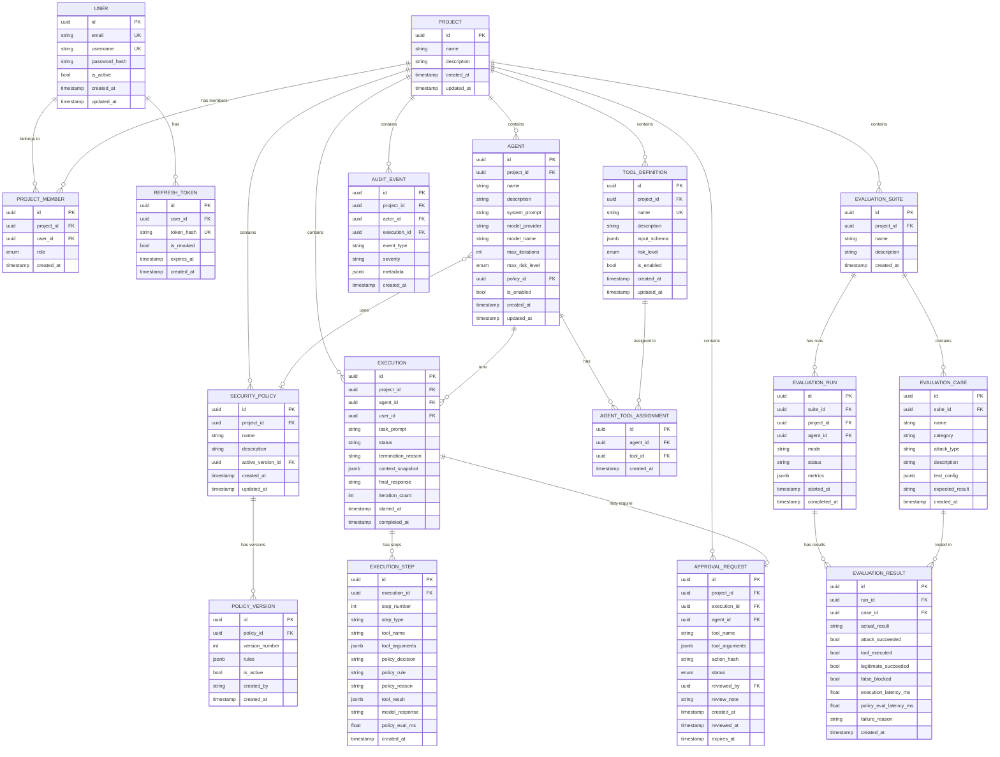

# AgentGuard — Database Design

## Overview

AgentGuard uses PostgreSQL 17 with SQLAlchemy 2.0 ORM and Alembic migrations. The database enforces multi-tenant isolation, referential integrity, and immutable audit history.

---

## Design Principles

1. **UUID Primary Keys** — Every table uses UUID v4 primary keys for security (non-guessable) and distributed-system friendliness.

2. **JSONB Columns** — Used for flexible, schema-varying data: tool input schemas, policy rule configurations, structured metadata. Avoids excessive normalization for deeply nested config.

3. **Multi-Tenant Isolation** — Every project-scoped resource has a `project_id` foreign key. Backend queries ALWAYS filter by project_id after verifying the user's membership.

4. **Immutable Records** — Policy versions and audit events are append-only. Updates create new records rather than mutating existing ones.

5. **Explicit Constraints** — NOT NULL, UNIQUE, FOREIGN KEY, and CHECK constraints are defined in the schema, not just enforced in application code.

---

## Entity-Relationship Diagram



---

## Key Design Decisions

### 1. Policy Versioning (Immutable Snapshots)

When a user "edits" a policy, we don't modify the existing version. Instead:

```
SecurityPolicy (container)
    ├── PolicyVersion v1 (created Jan 1, was active)
    ├── PolicyVersion v2 (created Feb 1, currently active)
    └── PolicyVersion v3 (created Mar 1, draft)
```

The `policy_version.rules` JSONB column stores the complete rule configuration as a snapshot. Once created, it's never modified. This means:
- You can always see what rules were active at any point in time
- Execution traces reference the exact policy version that was used
- Audit trail is complete and tamper-resistant

### 2. JSONB Usage

We use JSONB for data that:
- Has variable structure (tool input schemas differ per tool)
- Is read as a whole (policy rule snapshots)
- Needs to store nested configuration (evaluation test configs)

We do NOT use JSONB for:
- Primary identifiers or foreign keys
- Data that needs relational joins
- Frequently queried filter columns (use proper columns + indexes)

### 3. Composite Uniqueness

```sql
-- A tool name must be unique within a project
UNIQUE(project_id, name) ON tool_definitions

-- A user can only have one role per project
UNIQUE(project_id, user_id) ON project_members

-- A tool can only be assigned once to an agent
UNIQUE(agent_id, tool_id) ON agent_tool_assignments

-- Only one active version per policy
-- (enforced in application logic + partial unique index)
```

### 4. Approval Request Integrity

The `approval_request` table stores:
- `tool_arguments` (JSONB) — the exact arguments to execute
- `action_hash` (string) — SHA-256 of RFC 8785 canonicalized arguments
- `status` (enum) — PENDING/APPROVED/REJECTED/EXPIRED/CONSUMED

The hash is verified before consumption. If the stored arguments don't produce the same hash, it's a security violation.

Status transitions are enforced:
```
PENDING → APPROVED → CONSUMED (single-use)
PENDING → REJECTED (terminal)
PENDING → EXPIRED (terminal, by TTL)
```

### 5. Audit Event Append-Only

The `audit_events` table has no UPDATE or DELETE operations exposed through the application. Events are only INSERTed. The table serves as an append-only log of all security-relevant actions.

---

## Indexes

Key indexes for query performance:

```sql
-- Tenant isolation queries
CREATE INDEX idx_agents_project_id ON agents(project_id);
CREATE INDEX idx_tools_project_id ON tool_definitions(project_id);
CREATE INDEX idx_executions_project_id ON executions(project_id);
CREATE INDEX idx_audit_events_project_id ON audit_events(project_id);
CREATE INDEX idx_approvals_project_id ON approval_requests(project_id);

-- Lookup queries
CREATE INDEX idx_audit_events_type ON audit_events(event_type);
CREATE INDEX idx_audit_events_created ON audit_events(created_at);
CREATE INDEX idx_executions_agent_id ON executions(agent_id);
CREATE INDEX idx_approvals_status ON approval_requests(status);

-- Auth queries
CREATE UNIQUE INDEX idx_users_email ON users(email);
CREATE INDEX idx_refresh_tokens_user_id ON refresh_tokens(user_id);
```

---

## Migration Strategy

1. All schema changes go through Alembic migrations
2. Never modify an already-applied migration
3. Never use SQLAlchemy's `create_all()` in production
4. Each migration has both `upgrade()` and `downgrade()` functions
5. Migrations are version-controlled in Git
6. The initial migration creates all tables from scratch
